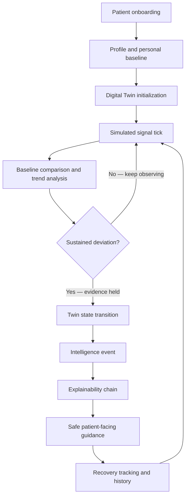
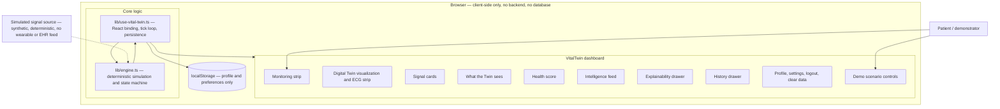

# VitalTwin

> **An intelligent patient Digital Twin prototype that learns a personal baseline, observes changing health signals, detects meaningful deviations, and explains what it sees.**


**Digital Twin Challenge 2026** · Prototype & Code Submission · Healthcare concept: **Patient Digital Twin / proactive digital health monitoring**

| | |
|---|---|
| **Team** | After Eclipse |
| **Team leader** | Akash Selvaraj R · rakashselvaraj@gmail.com |
| **Institution** | SRM Institute of Science and Technology |
| **Repository** | https://github.com/Akash-Selvaraj-R/VitalTwin |

> ⚕️ **Safety notice:** VitalTwin is a software prototype built on **simulated health data** for competition demonstration. It is **not a medical device** and provides no diagnosis, treatment, emergency response, or professional medical advice. Details in [§15 Safety & Clinical Scope](#15-safety--clinical-scope).

---

## 1. Overview

Health dashboards are good at showing numbers and poor at explaining them. A heart-rate reading of 88 bpm, an oxygen value of 96%, a temperature of 37.2 °C — each is technically correct and clinically almost meaningless in isolation, because **normal is personal**. One person's ordinary Tuesday is another person's departure from their own pattern.

VitalTwin explores the missing layer: a **patient-facing Digital Twin** that maintains a personal baseline, continuously compares evolving signals against *that patient's* baseline, and turns meaningful changes into understandable intelligence — each with a full explanation of what was seen, what changed, why it matters, and what the patient can safely consider doing next.

Implemented end-to-end and running entirely in the browser:

- Patient onboarding with a private, local-only profile
- Personalized Digital Twin (baseline derived from age, sex, body measures, activity level)
- Live simulated monitoring with an evolving twin visualization, ECG strip, and signal cards
- Contextual health score with a transparent breakdown
- Twin states: **STABLE**, **ATTENTION**, **RECOVERING**
- Contextual intelligence events, generated only for sustained deviations
- Six-step explainability chain for every event
- History (24H / 7D / 30D) with live captures
- Demo scenario controls (stable day, elevated signals, recovery, time fast-forward)
- Profile, settings, guided tour, logout, clear-local-data
- Local persistence with malformed-data repair; reduced-motion support; responsive layout

**This is a proof-of-concept.** It is designed to make the *concept* of an explainable health Digital Twin concrete, discussable, and honest about its boundaries.

## 2. Problem Statement

Health signals are difficult to interpret when viewed as isolated measurements.

A useful Digital Twin must therefore provide **context around changing signals**, not merely display raw values:

- A patient's normal baseline differs from another person's baseline — a single universal threshold cannot be the complete interpretation.
- Raw values answer *"what is the number?"*; patients and clinicians actually need *"what changed, for this person, since when, and why does it matter?"*
- Without context, the same reading can produce either needless anxiety or unwarranted reassurance.

VitalTwin investigates how a patient-centric Digital Twin can continuously compare simulated signals with a personal baseline and communicate meaningful changes in an understandable, non-diagnostic way.

## 3. Healthcare Use Case

A patient uses VitalTwin for proactive, personal health awareness:

```
Patient creates a profile
  → establishes a personal baseline
  → Digital Twin is created
  → live simulated signals evolve
  → Twin observes deviations from that baseline
  → a contextual intelligence event appears
  → explainability shows exactly why
  → patient sees safe, non-diagnostic next-step guidance
  → recovery is reflected as signals return toward baseline
```

During monitoring the Twin reports one of three states — **STABLE**, **ATTENTION**, **RECOVERING** — derived from sustained deviations rather than momentary noise. Scenario controls let a demonstrator move a session through **STABLE DAY**, **ELEVATED SIGNALS**, and **RECOVERY** trajectories.

The prototype is designed for **patient-facing digital health exploration and demonstration**: it shows how baseline-relative context could be communicated to a person, not how a clinician should be advised.

## 4. Core Concept — Personal Baseline

**Your baseline is personal.**

VitalTwin compares current simulated signals with the patient's **own** baseline rather than treating one universal threshold as the complete interpretation. During onboarding, the engine derives per-signal baselines from profile features — age, sex, height and weight (→ BMI), and activity level — using transparent, adjustable heuristics (see `computeBaseline` in `lib/engine.ts`).

During monitoring, every reading is judged relative to that baseline: each signal carries a per-signal *tolerance* (normal physiological wander) and a *major deviation* threshold. A signal is reported as **within your recent pattern**, **above your recent pattern**, or **below your recent pattern** — the deviation is personal, not generic.

This matters conceptually because it changes the question being answered. A population threshold asks *"is this value abnormal?"*; a personal baseline asks *"is this abnormal **for you**?"* — which is the only version of the question a Digital Twin can answer responsibly for an individual.

## 5. How VitalTwin Works

1. **Patient onboarding** — name, age, sex, height, weight, activity level (plus optional conditions, medications, allergies). Local-only.
2. **Profile and baseline creation** — per-signal personal baselines derived from the profile.
3. **Digital Twin initialization** — a deterministic seed is derived from the profile and drives both the signal noise and the synthetic history, so the same profile replays identically.
4. **Signal simulation** — each tick advances eight simulated signals toward the active scenario target with deterministic, bounded noise.
5. **Trend / state evaluation** — readings are compared to the personal baseline; deviations must be **sustained across consecutive ticks** before they count as evidence; the state machine then decides STABLE / ATTENTION / RECOVERING with hysteresis.
6. **Intelligence event generation** — only meaningful transitions produce a timestamped, contextual event.
7. **Explainability** — each event carries a structured causal chain (what the twin saw → your baseline → change detected → signals involved → why it matters → what you can do).
8. **Patient-facing guidance** — deliberately safe, non-diagnostic language.
9. **Recovery tracking** — recovery targets sit inside per-signal tolerance so a drifted system visibly settles back to STABLE.
10. **History** — 24H / 7D / 30D synthetic timeline plus live session captures.



## 6. Digital Twin Architecture

All health computation lives in one pure, framework-free module; React only binds it to the UI.

| File | Responsibility |
|---|---|
| `lib/engine.ts` | Pure deterministic simulation + state machine: personal baseline derivation, signal simulation, per-signal deviation analysis, sustained-deviation streaks, twin state transitions, health score, intelligence events, explainability payloads, history generation, scenario targets, formatting helpers. No React, no DOM, no `Math.random`. |
| `lib/use-vital-twin.ts` | React binding: localStorage persistence and sanitization, hydration flag, live tick loop (cleaned up on unmount), elapsed-time tick, scenario / burst / reset controls, overlay and session state, Escape-key dismissal, reduced-motion preference. |
| `lib/utils.ts` | Shared `cn()` class-merge helper. |
| `app/page.tsx` | Composition root: dashboard layout, header/navigation, boot splash, greeting, drawer + tour composition, focus management and keyboard handling. |
| `app/layout.tsx` | Root layout, metadata, theme color, Vercel Analytics (production builds only). |
| `components/onboarding.tsx` | Profile creation flow with validation; writes the local-only profile. |
| `components/digital-twin.tsx` | `DigitalTwin` — abstract twin visualization (state-reactive, sex-aware silhouette) and `EcgStrip` — simulated ECG rendering. |
| `components/health-score.tsx` | Health score with transparent alignment / recovery / stability breakdown. |
| `components/monitoring-strip.tsx` | Live monitoring state, start/pause, elapsed monitoring time, last update, sync quality, signal count. |
| `components/signal-card.tsx` | One simulated signal with its personal baseline comparison and trend. |
| `components/twin-sees.tsx` | Panel giving the user a mental model of what the Twin is currently watching. |
| `components/intelligence-feed.tsx` | Feed of engine-generated events (aria-live), contextual and timestamped. |
| `components/explainability-drawer.tsx` | The six-step causal chain and safe next-step guidance. |
| `components/history-drawer.tsx` | 24H / 7D / 30D timeline: deterministic synthetic backfill plus live session captures. |
| `components/account-drawers.tsx` | Profile and settings drawers, logout and clear-data confirmations. |
| `components/tour-overlay.tsx` | Seven-step guided tour of the interface. |
| `components/demo-controls.tsx` | Clearly marked synthetic trajectory controls for demonstration. |

**Data / control flow:** `onboarding → use-vital-twin (profile → baseline → engine state) → engine tick → readings, score, state, events → dashboard components → user opens an event → explainability drawer reads the event's explanation payload`. Profile and settings are written to `localStorage`; nothing else is persisted and nothing leaves the browser.

## 7. System Architecture Diagram



## 8. Technical Stack

| Layer | Choice |
|---|---|
| Framework | Next.js 16 (App Router) · React 19 |
| Language | TypeScript 5.7 (strict) |
| Styling | Tailwind CSS 4 + custom neo-brutalist design system (`app/globals.css`, `app/live.css`) |
| UI | Hand-built components, `lucide-react` icons, Base UI primitives, `class-variance-authority` / `clsx` / `tailwind-merge` |
| Intelligence | Custom deterministic client-side engine (`lib/engine.ts`) — no ML dependencies |
| State | Single React hook (`lib/use-vital-twin.ts`) with cleaned-up intervals |
| Persistence | `localStorage` only, sanitized on read |
| Analytics | Vercel Analytics (production builds only; no health data collected) |
| Package manager | pnpm 11 (`packageManager: pnpm@11.23.0`) |

No environment variables are required to run the prototype.

## 9. AI / ML / Intelligence Framework Details

> **VitalTwin's current competition prototype uses a deterministic client-side health-signal simulation and rule/state engine rather than a trained clinical ML model.** This allows the Digital Twin behavior, transitions, recovery patterns, and explainability flow to remain reproducible during demonstration.

There is **no trained model, no training data, and no inference runtime** in this repository. The intelligence layer is deliberately interpretable — every output traces to explicit inputs:

- **Signal generation** — eight simulated signals (heart rate, SpO₂, temperature, respiratory rate, blood pressure, stress load, recovery, movement) advance toward the active scenario target each tick (1200 ms), perturbed by deterministic hash-based noise. Values are clamped to physiological bounds. There is no `Math.random` anywhere, so the same profile replays identically.
- **Personal baseline comparison** — each signal is compared against the patient's own baseline with per-signal tolerance and major-deviation thresholds.
- **Sustained deviation detection** — a deviation must persist for **5 consecutive ticks** (`ACTIVATION_TICKS`) before the Twin treats it as evidence. This is the anti-noise rule: a single-tick graze never fires an alert.
- **State transitions** — a hysteresis state machine (STABLE / ATTENTION / RECOVERING) combines the count of sustained deviations, the count of major deviations, the direction of the trend, and the active scenario. Transitions are deliberate, not flickery.
- **Health score** — a transparent weighted blend of baseline **alignment** (0.42), **recovery** (0.33), and **stability** (0.25, penalized by meaningful and major deviations), labelled ALIGNED / STEADY / SHIFTING / STRAINED.
- **Event generation** — only meaningful transitions produce events; each carries a structured explanation payload (what was seen, the baseline, the detected change, signals involved, why it matters, a safe next step).
- **Recovery behavior** — recovery scenario targets sit inside per-signal tolerance, so a drifted system visibly settles back to STABLE instead of hovering at the alert threshold.

The architecture keeps the baseline layer replaceable: a learned, patient-specific baseline model could be substituted **without changing the surrounding UX or the explanation contract**.

## 10. Explainability

Every intelligence event opens into a six-step causal chain, in plain patient-friendly language:

**WHAT THE TWIN SAW → YOUR BASELINE → CHANGE DETECTED → SIGNALS INVOLVED → WHY IT MATTERS → WHAT YOU CAN DO**

The chain shows the actual values used in the decision — the observed reading, the personal baseline it was compared against, and the size and direction of the change — so the event can be audited rather than trusted blindly. The final step is intentionally **non-diagnostic**: it offers safe, general next-step considerations (rest, hydration, re-checking later, or speaking with a clinician) and never asserts a cause, a condition, or a diagnosis.

## 11. Live Monitoring

Pressing **START LIVE MONITORING** begins the simulation loop:

- Six live signal cards — heart rate, blood oxygen, temperature, respiratory rate, stress load, recovery — each with its personal baseline comparison and trend
- A state-reactive Digital Twin visualization and a simulated ECG strip
- A contextual health score with a visible breakdown
- A monitoring strip showing monitoring state, elapsed time, last update, sync quality, and signal count
- An intelligence feed (aria-live) that announces new events as they occur

**All signals shown are simulated.** The UI labels signals, the ECG strip, and history as simulated wherever they appear, and carries a persistent notice that observations are contextual signals from simulated data — not medical diagnoses.

## 12. Demo Scenarios

The `demo-controls` panel exposes synthetic trajectory controls, each visibly marked as a demo control.

| Scenario | Purpose | Expected Twin behavior | What the jury can observe |
|---|---|---|---|
| **STABLE DAY** (default) | Establish a normal day for this patient | Signals hover inside per-signal tolerance → Twin remains **STABLE**, no alert events | Every card reads "within your recent pattern"; health score stays high (label ALIGNED / STEADY) |
| **ELEVATED SIGNALS** | Coherent multi-signal drift relative to *this* patient's baseline | Signals drift together (from the code: heart rate +19 BPM, blood oxygen −2.3 points, temperature +0.45 °C, respiratory rate +4/min, stress load +41 points, recovery −25 points versus baseline); once deviations are **sustained for 5 ticks** the Twin moves to **ATTENTION** and an intelligence event fires | Cards flip to "above / below your recent pattern"; score drops (SHIFTING / STRAINED); event appears in the feed and opens into the full explainability chain |
| **RECOVERY** | Return toward baseline | Targets sit inside tolerance, so the Twin moves **ATTENTION → RECOVERING → STABLE** and recovery events mark the return | Twin visibly settles; "returned to your pattern" events; score climbs back |

Time controls: **+1 HOUR** and **+6 HOURS** fast-forward the propagation (4 sub-steps per simulated hour at 200 ms), alongside **PAUSE** and **RESET**. Every state can be reached, explained, and exited — no dead ends.

## 13. Patient Experience

- **Onboarding** — name (required), age, sex, height, weight, activity level, plus optional known conditions, medications, and allergies
- **Personalized profile** — patient card with the derived baseline context
- **Guided tour** — seven-step overlay explaining the interface (replayable from settings)
- **Digital Twin visualization** — state-reactive abstract twin and simulated ECG strip
- **Live monitoring** — signal cards, health score, monitoring strip, intelligence feed
- **Explainability** — six-step causal chain per event, with safe next-step guidance
- **History** — 24H / 7D / 30D timeline with live session captures
- **Profile & settings** — edit profile, reduced-motion toggle, replay tour
- **Logout & clear data** — explicit confirmations; clearing removes the local profile and preferences and returns to onboarding
- **Responsive** — desktop, tablet, and mobile layouts; keyboard accessible (Escape closes layers, focus moves into dialogs, dialog semantics and live regions)

## 14. Data & Privacy

- All health signals in this prototype are **synthetic / simulated** — no real patient data is required or used.
- The patient profile and the reduced-motion preference are stored **locally in the browser** (`localStorage`, keys `vital-twin-profile` and `vital-twin-reduced`).
- **There is no backend patient database.** No profile or health value is transmitted anywhere by the application.
- Stored values are sanitized on read: malformed JSON or out-of-range values are repaired or cleared instead of crashing the app.
- **Clearing local data removes the local profile, twin state, and preferences** — this is confirmed via an explicit dialog.
- No encryption is claimed: this is browser-local demo storage, not a protected health record.

## 15. Safety & Clinical Scope

**VitalTwin is a software prototype and research / competition proof-of-concept. It uses simulated health data and does not provide medical diagnosis, treatment, emergency response, or professional medical advice.**

- It is **not** a medical device, and claims no medical device status, regulatory approval, clinical validation, or diagnostic accuracy.
- It is **not** deployed in any hospital or clinic, and no real patient monitoring takes place.
- All language in the interface is deliberately non-diagnostic: *"signal"*, *"pattern"*, *"elevated"*, *"outside your usual baseline"*, *"consider seeking medical advice"*.
- Nothing in the prototype should be relied upon for a health decision.

## 16. Limitations

These limitations **define the current proof-of-concept scope** rather than defects:

- **Simulated physiology** — signals are procedurally generated, not measured; no clinical prediction model exists.
- **Browser-local persistence** — the profile lives in one browser on one device; no cloud sync, no multi-device continuity.
- **No backend** — no patient database, no API, no clinician-facing view.
- **No real wearable integration** — no sensor, device, or health-platform feed is connected.
- **No real EHR integration** — no hospital or clinical system is connected.
- **No ABHA / ABDM integration** — no national health ID linkage.
- **No emergency response automation** — the Twin observes and explains; it never calls, alerts, or escalates.
- Deterministic replay means a long-running session can eventually show one gentle "wander" episode — intentional, so the explainability flow has something real to explain.

## 17. Future Scope

*Clearly future directions — none of these are implemented in this repository:*

- Wearable and sensor data integration
- Real longitudinal patient data
- Cloud synchronization across devices
- Healthcare interoperability standards
- ABHA / ABDM integration
- Clinically validated predictive models
- Trusted-contact notification workflows
- Location-aware emergency assistance
- Hospital and clinician integration

## 18. Installation

Requirements: **Node.js 20+**, **pnpm 11** (`corepack enable` activates the pinned version).

```bash
git clone https://github.com/Akash-Selvaraj-R/VitalTwin.git
cd VitalTwin
pnpm install
pnpm dev          # http://localhost:3000
```

Production build and serve:

```bash
pnpm build        # production build, TypeScript-validated
pnpm start        # serve the production build
```

No environment variables are required.

## 19. Project Structure

```
VitalTwin/
├── app/
│   ├── page.tsx            # composition root (dashboard, drawers, tour)
│   ├── layout.tsx          # root layout, metadata, analytics
│   ├── globals.css         # design system + refinements
│   └── live.css            # neo-brutalist overrides
├── components/             # onboarding, digital-twin (+ ECG), health-score,
│                           # monitoring-strip, signal-card, twin-sees,
│                           # intelligence-feed, explainability-drawer,
│                           # history-drawer, account-drawers, tour-overlay,
│                           # demo-controls
├── lib/
│   ├── engine.ts           # deterministic simulation + state machine
│   ├── use-vital-twin.ts   # React binding, persistence, tick loop
│   └── utils.ts            # class-merge helper
├── public/                 # icons
├── LICENSE                 # MIT
└── package.json            # pnpm scripts
```

## 20. Demo Video

> **15–20 minute competition demonstration video — To be added before final submission.**

*Suggested walkthrough for the recording:* introduce the patient and the concept → complete onboarding → guided tour → show the personal baseline comparison → start live monitoring → watch signals, score, and twin state → trigger **ELEVATED SIGNALS** → open an intelligence event and read the explainability chain → switch to **RECOVERY** and watch the Twin settle → fast-forward to show full propagation → review history (24H / 7D / 30D) → profile, settings, logout, and clear data.

## 21. Competition Submission Assets

| Asset | Status |
|---|---|
| GitHub Repository | Available — https://github.com/Akash-Selvaraj-R/VitalTwin |
| README | Finalized |
| Demo Video | To be added before final submission |
| Architecture Diagram (PDF/PPT) | To be added before final submission |
| Presentation (PDF/PPT) | To be added before final submission |

## 22. Team Details

| | |
|---|---|
| **Team name** | After Eclipse |
| **Team leader** | Akash Selvaraj R |
| **Email** | rakashselvaraj@gmail.com |
| **College** | SRM Institute of Science and Technology |
| **Incubator** | Not applicable |

## 23. License

This project is open source under the **MIT License** — see [LICENSE](LICENSE).

## 24. Disclaimer

VitalTwin is a student proof-of-concept built for the Digital Twin Challenge 2026. It uses **simulated health data**, runs entirely in the browser, and is **not a medical device**. It does not diagnose, treat, monitor real patients, detect emergencies, or replace professional medical advice. If you have a health concern, consult a qualified clinician.

---

*VitalTwin — a calm, explainable proof-of-concept for personal health intelligence. Simulated data. Not a medical device.*
